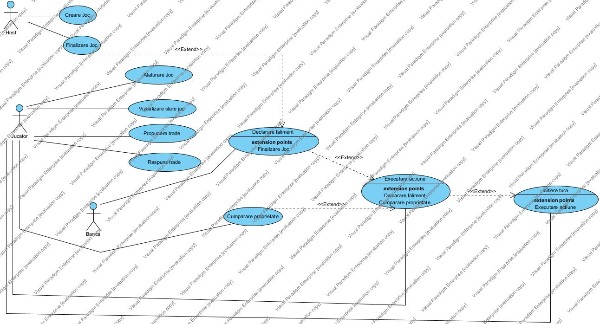

# Descrierea problemei — API Joc Europolis

**Proiect:** Programare Web — Joc de tip Europolis
**Etapa:** 1 - Descrierea API-ului și modelarea problemei  

---

## 1. Contextul problemei

Jocul Europolis este un joc de societate în care 2–6 jucători concurează pentru acumularea de proprietăți și capital, cu scopul de a-i aduce pe ceilalți la faliment.

Problema constă în **modelarea acestui joc ca o aplicație web**, în care logica de joc este expusă printr-un API REST, iar unul sau mai mulți clienți interacționează cu serverul prin mesaje HTTP.

**De ce un API REST?**

Separarea logicii de joc (backend) de interfața vizuală (frontend) permite:

- mai mulți clienți să joace simultan din dispozitive diferite
- validarea regulilor într-un singur loc (serverul)
- posibilitatea extinderii ulterioare (AI, spectatori, replay)

---

## 2. Arhitectura generală a sistemului

Sistemul are trei componente principale:

```
[ Client A ]  ──HTTP──┐
[ Client B ]  ──HTTP──┼──► [ API Server ] ──► [ Baza de date ]
[ Client C ]  ──HTTP──┘
```

| Componentă | Responsabilitate |
|---|---|
| **Client** | Interfața vizuală. Afișează tabla, trimite acțiunile jucătorului, redă starea curentă. |
| **API Server** | Nucleul aplicației. Expune endpoint-uri REST, validează acțiunile conform regulilor, actualizează și returnează starea. |
| **Baza de date** | Persistă starea jocurilor, profilurile jucătorilor și istoricul turelor. |

Comunicarea este **sincronă prin REST** pentru acțiunile jucătorilor. Opțional, notificările în timp real (ex: alt jucător a cumpărat o proprietate) pot fi trimise prin **WebSocket** sau **polling** periodic.

---

## 3. Descrierea modelului problemei

### 3.1 Entități principale

| Entitate | Descriere |
|---|---|
| `Game` | O sesiune de joc; are o stare (waiting / active / finished), o tablă, jucători și o tură curentă. |
| `Player` | Un participant; are un sold, o poziție pe tablă, proprietăți deținute, datorii active și un status (activ / falimentar). |
| `Board` | Tabla de joc; conține 40 de căsuțe aranjate circular. |
| `Tile` | O căsuță a tablei (proprietate, taxă, șansă, comunitate, închisoare, START, etc.). |
| `Property` | Un tip de `Tile` cumpărabil; aparține unui grup de culoare, are prețuri de chirie pe niveluri și poate fi ipotecată. |
| `Building` | Casă sau hotel construit pe o proprietate. |
| `Trade` | O tranzacție de negociere între doi jucători (proprietăți + bani). |
| `Card` | O carte de șansă sau comunitate; are un efect (mișcare, plată, colectare, ieșire închisoare). |
| `Turn` | O tură a unui jucător; conține zarurile aruncate, acțiunile disponibile și acțiunea executată. |
| `Bank` | Entitate singleton per joc; gestionează stocul de clădiri, banii disponibili și împrumuturile acordate. |
| `Loan` | O datorie înregistrată între un jucător și Bancă; conține suma împrumutată din vânzarea unei propietăți. |

### 3.2 Relații cheie

- Un `Game` conține mai mulți `Player` și o singură `Board`
- Un `Board` conține exact 40 de `Tile`-uri
- Un `Player` poate deține zero sau mai multe `Property`
- O `Property` poate avea zero sau mai multe `Building` (max 4 case sau 1 hotel)
- O `Property` poate fi ipotecată (`mortgaged: bool`), caz în care nu generează chirie
- Un `Game` are o succesiune de `Turn`-uri
- Un `Turn` aparține unui singur `Player`
- Un `Player` poate ipoteca una sau mai multe "Property" pentru un sau mai multe `Loan`-uri

---

## 4. Fluxul general al unui joc

### Faza 1 — Inițializare

1. Un jucător creează un joc (`POST /games`), configurând numărul de participanți.
2. Ceilalți jucători se alătură (`POST /games/{id}/players`).
3. Când toți sunt pregătiți, host-ul pornește jocul (`PATCH /games/{id}` cu `status: active`).

### Faza 2 — Desfășurare (ciclu repetat)

1. Jucătorul curent aruncă zarurile (`POST /games/{id}/turns`).
2. Serverul calculează noua poziție și determină acțiunea declanșată pe căsuța respectivă.
3. Jucătorul execută acțiunea disponibilă (cumpărare, plată chirie, pescuire carte etc.) prin `POST /games/{id}/turns/{n}/actions`.
4. Opțional, în afara turei proprii, jucătorii pot iniția schimburi (`POST /games/{id}/trades`) de la Bancă.
5. Tura se încheie și trece la următorul jucător.

### Faza 3 — Finalizare

1. Un jucător ajunge la sold negativ și nu poate achita o datorie → declară faliment (`PATCH /players/{id}` cu `status: bankrupt`).
2. Activele sale sunt redistribuite conform regulilor.
3. Jocul se termină când rămâne un singur jucător activ.

---

## 5. Constrângeri și reguli de business relevante pentru API

Acestea sunt regulile validate de server, care generează coduri de eroare specifice:

| Regulă | Cod HTTP | Descriere |
|---|---|---|
| Un jucător poate acționa doar în tura sa | `403 Forbidden` | Cererea vine din afara turei active |
| Nu poți cumpăra o proprietate deja deținută | `409 Conflict` | Proprietatea aparține altui jucător |
| Nu poți construi fără monopol complet pe grup | `422 Unprocessable Entity` | Nu deții toate proprietățile din culoare |
| Maximum 4 case sau 1 hotel per proprietate | `422` | Limita de clădiri depășită |
| Zarurile se aruncă o singură dată per tură | `409` | Excepție: dublu permite tură nouă |
| Nu poți ipoteca o proprietate cu clădiri pe ea | `422` | Clădirile trebuie vândute înainte |
| Jucătorul în închisoare - condiții de eliberare | `422` | Plată, carte specială sau dublu |
| Schimburile sunt valide doar pentru bunuri proprii | `403` | Inițiatorul nu deține bunurile oferite |

---

## 6. Actorii sistemului

| Actor | Rol |
|---|---|
| **Jucător** | Participare joc, executare acțiuni în tură proprie, inițiere trade-uri |
| **Host / Creator joc** | Inițiere joc, configurare, pornire, expulzare jucători |
| **Bancă (sistem)** | Gestionare automată tranzacții, validare reguli, distribuire cărți, acordare împrumuturi |
| **Spectator** *(opțional)* | Vizualizare stare joc, fără acțiuni de scriere |

---

## 7. Diagrama Use-Case



---

## 8. Arhitectura

```
EUROPOLIS/
├── server.js               # Entry point - inițializare Express
├── app/                    # Controllere HTTP
├── routes/                 # Definire endpoint-uri REST
├── middlewares/            # Validare, autentificare, erori
├── services/               # Logica de business (reguli joc)
├── repositories/           # Acces la baza de date
├── models/                 # Entități: Game, Player, Turn, Trade
├── node_modules            # Packages
├── utils/                  # Funcții utilitare
├── public/                 # Frontend static (HTML, CSS, JS)
│   ├── css/
│   ├── js/
│   └── images/
├── views/                  # Template-uri HTML
├── tests/                  # Teste unitare / integrare
├── docs/                   # Documentație
│   ├── api-description.md
│   ├── problem-description.md
│   ├── openapi.yaml
│   └── PW_Europolis.jpg
├── .env                    # Variabile de mediu
└── package.json
```

---

## 9. Ce este în afara scopului (out of scope) — Etapa 1

- Autentificare și conturi de utilizator (ID simplu per jucător)
- Salvarea și reluarea jocurilor întrerupte
- Modul spectator în timp real (WebSocket)
- Variante de tablă personalizate (doar tabla standard 40 căsuțe)
- Logică AI pentru jucători automatizați

---